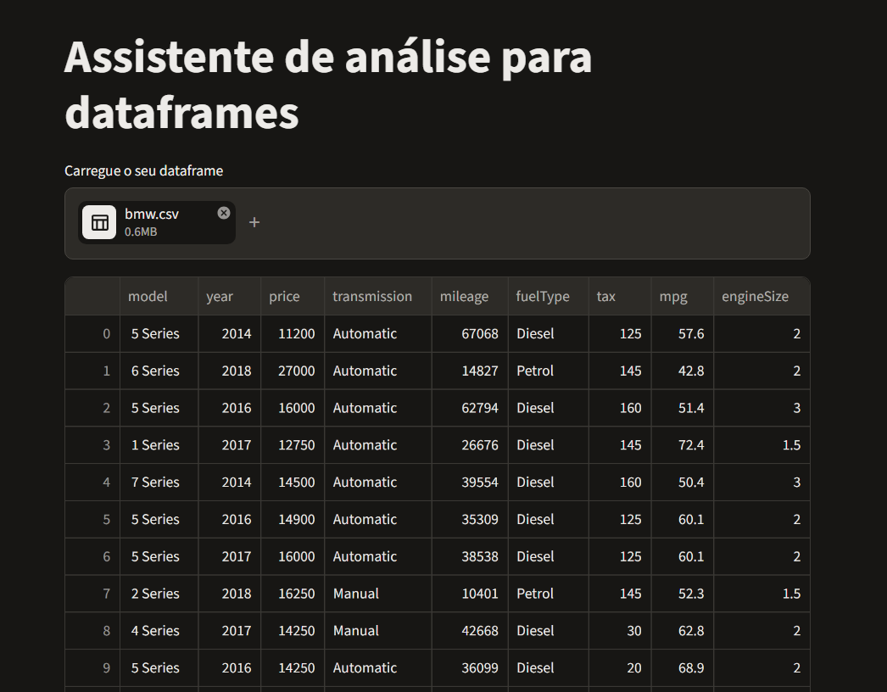
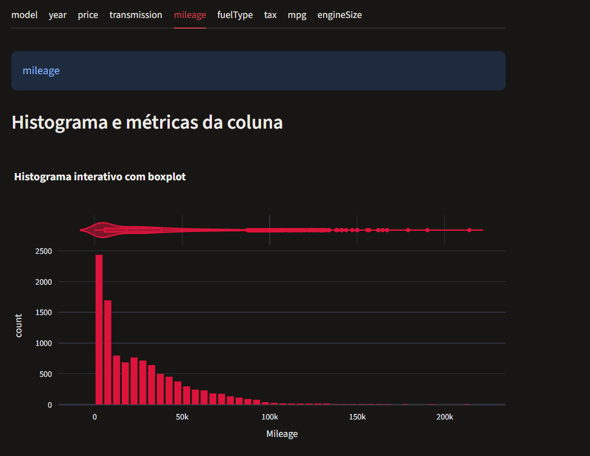
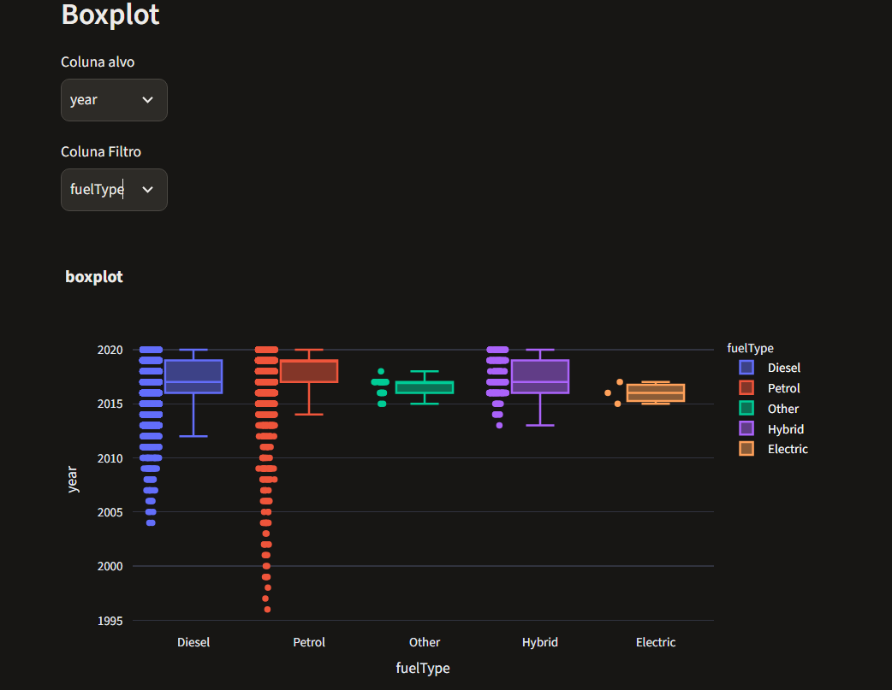

Projeto tentando criar um leitor de datasets genérico com funções de plotagem,tratamento de erros, calculo de métricas e ajuste de curvas teóricas usando funções das bibliotecas numpy,pandas(para os cálculos e manipulação de datasets), plotly(para gerar gráficos interativos) e streamlit(criando a interface que apresenta o resultado da utilização das outras bibliotecas).

A ideia é ser uma interface de fácil utilização para funções básicas de uma análise exploratória de dados, possibilitando a criação de gráficos e análise do comportamento dos dados que o dataset analisado tem.

Em implementação por Lenon Flores Moraes, cursando Ciência de dados e inteligência artificial na UFSM(Campus Cachoeira do Sul)

  
 Prints do app

   
  
  
  
  
  
  

